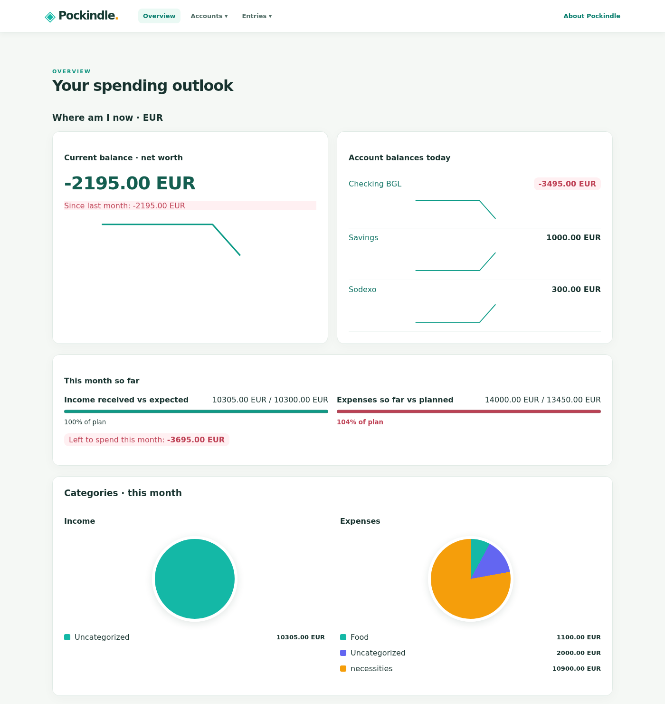
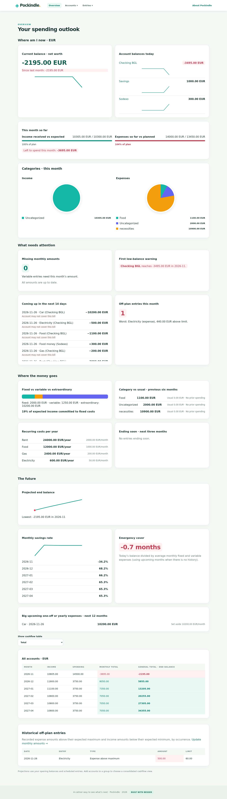
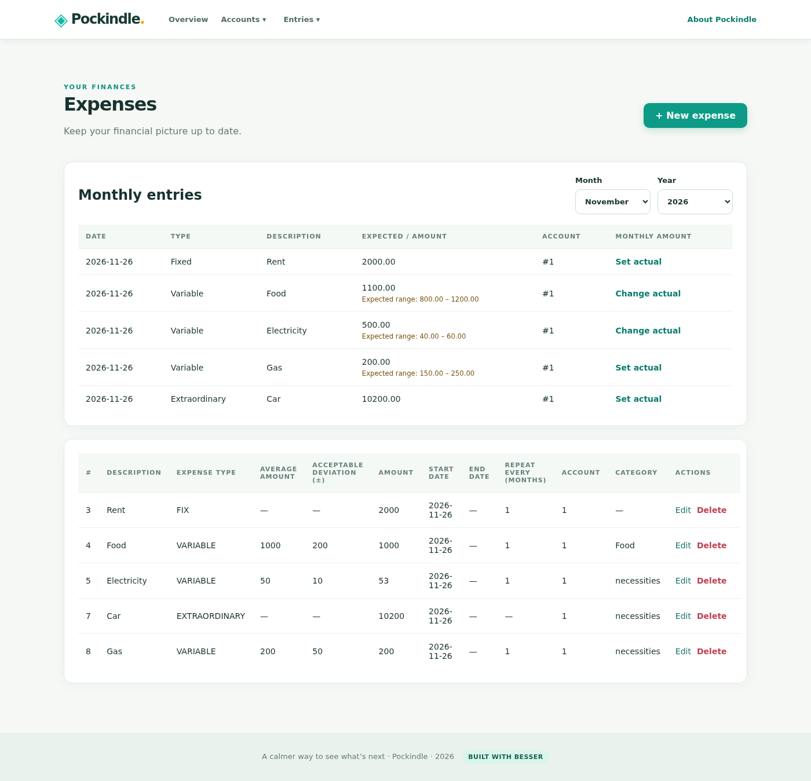
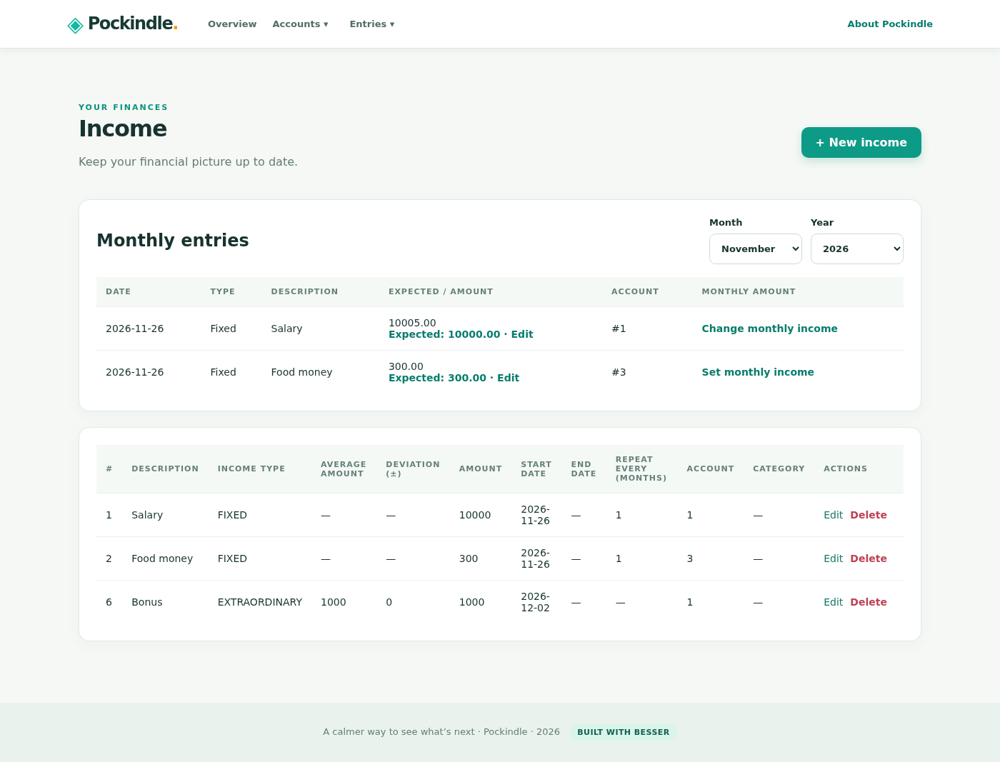
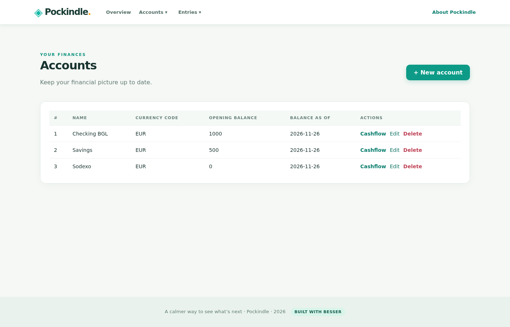
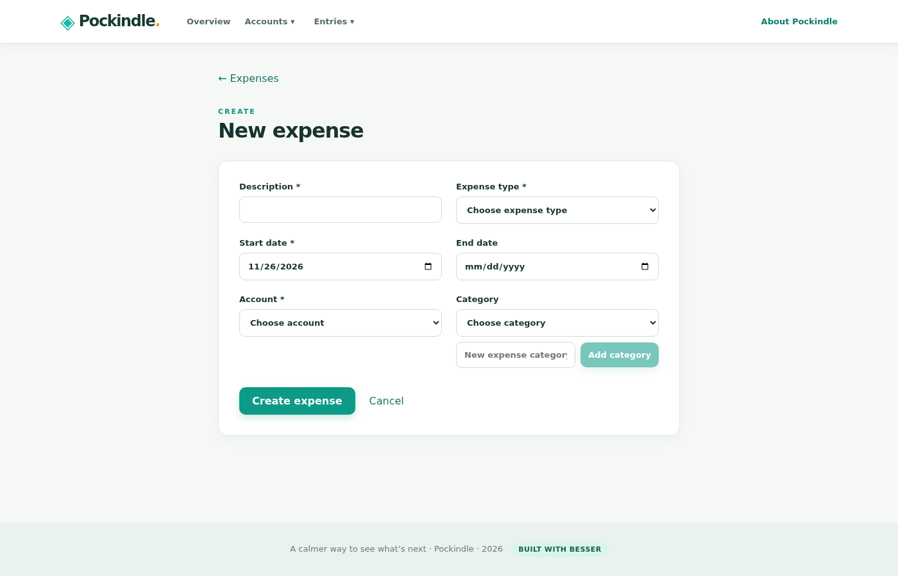
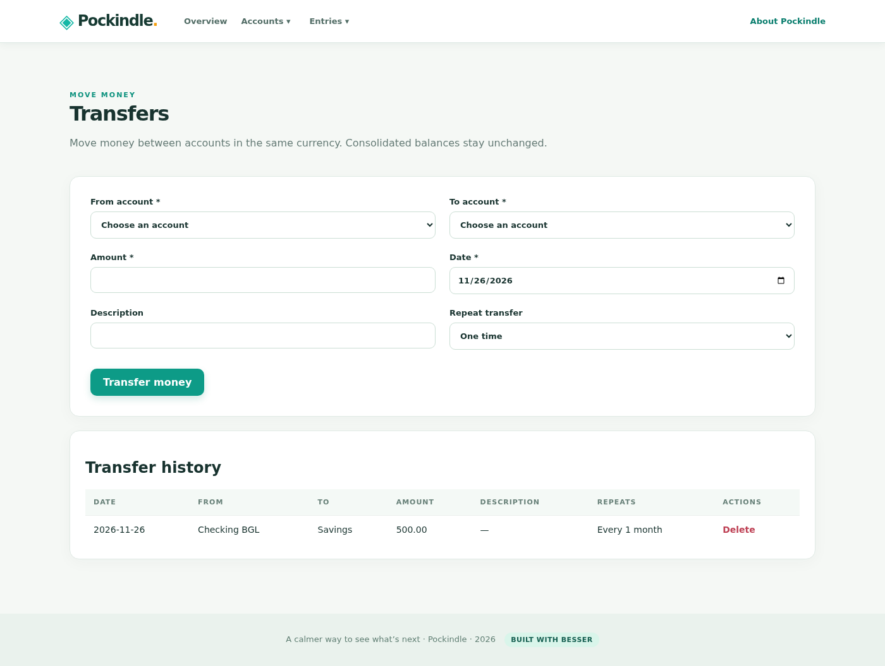

# Pockindle

**A calmer way to see what's next.** Pockindle is a personal finance web app
that shows where your money stands today and where it is heading over the
coming months. Record your accounts, income, expenses and transfers once,
including the ones that repeat. Pockindle then projects your balances forward
and points out what needs attention: overspending, missing amounts and a
balance that is about to go negative.



## Features

- **Multiple accounts and currencies.** Accounts in EUR, BRL or USD, each with
  an opening balance and the date it applies from. Every currency gets its own
  dashboard section.
- **Account groups.** Combine several accounts into one group to see a single
  forecast for all of them, for example "everything I own" or "household".
- **Income and expenses by type.**
  - *Fixed*: the same amount on a set schedule (rent, salary).
  - *Variable*: an expected average plus an allowed deviation (groceries,
    utilities). Each month you enter the actual amount, and Pockindle flags it
    when it falls outside the expected range.
  - *Extraordinary*: one-off items (a car, a bonus).
- **Recurring entries.** Any entry can repeat every *n* months, with an
  optional end date.
- **Categories.** Optional income and expense categories, which you can create
  directly from an entry form.
- **Transfers.** Move money between accounts in the same currency, once or on
  a schedule. Totals across accounts are unaffected.
- **Monthly cashflow projection.** For each future month: income, spending,
  monthly total and end-of-month balance, per account, per group or for
  everything combined.

## The overview dashboard

The dashboard is organised around four questions:

| Section | What it shows |
| --- | --- |
| **Where am I now** | Total balance (net worth) with the change since last month and a six-month trend; today's balance for each account, with negative balances in red. |
| **This month so far** | Income received against expected and expenses against planned, plus what is *left to spend* (yellow below 10% of monthly income, red below zero). Income and expenses for the month by category. |
| **What needs attention** | Variable entries still missing this month's amount, the first upcoming low-balance warning, bills due in the next 14 days, and entries outside their expected range. |
| **Where the money goes / The future** | Fixed vs. variable vs. extraordinary split, spending per category compared with the usual, yearly cost of recurring items, entries ending soon, projected end balance, monthly savings rate, emergency cover (in months of fixed and variable expenses), and large upcoming one-off costs. |

At the bottom are the six-month cashflow table and a history of off-plan
entries: expenses above their expected maximum and income below its expected
minimum.

<details>
<summary>Full dashboard screenshot</summary>



</details>

## Screenshots

### Expenses: monthly entries and actual amounts

Pick a month and year to see what is due. For variable expenses, the expected
range is shown next to the actual amount you enter.



### Income



### Accounts

Every account links to its own cashflow projection.



### Adding an expense

The form adapts to the expense type. Variable expenses ask for an average
amount and an acceptable deviation, and recurring types ask for a repeat
interval.



### Transfers



## Getting started in the app

1. **Add an account** (*Accounts → Individual Accounts → New account*) with
   its currency, opening balance and the date of that balance. If you have
   several accounts, you can then create a **group** to combine them.
2. **Add income and expenses** (*Entries → Income / Expenses*). Choose the
   type first, then set a repeat interval for anything recurring.
3. **Each month**, open the Income and Expenses pages, select the month and
   fill in the actual amounts of variable entries. Rows that still need an
   amount are highlighted in yellow.
4. **Check the Overview** for balances, alerts and the projected cashflow.

## How it's built

| Part | Stack | Location |
| --- | --- | --- |
| Frontend | React + Vite, React Router | [`frontend/`](frontend/) |
| Backend | FastAPI, SQLAlchemy, SQLite | [`backend/`](backend/) |
| Data model | B-UML (BESSER) | [`buml/`](buml/) |

The backend serves a REST API (interactive docs at `/docs`) along with the
dashboard and cashflow calculations ([`backend/cashflow.py`](backend/cashflow.py),
[`backend/monthly.py`](backend/monthly.py)). Data is stored in a local SQLite
file under `backend/data/`, which is not committed to the repository.

## Run it

```bash
docker compose up --build
```

| | |
| --- | --- |
| Web app | http://localhost:3000 |
| API | http://localhost:8000 |
| API docs | http://localhost:8000/docs |

## Run it without Docker

Use two terminals, each starting in this folder.

The API, on http://localhost:8000:

```bash
cd backend
pip install -r requirements.txt
python main_api.py
```

The web app, on http://localhost:5173:

```bash
cd frontend
npm install
npm run dev
```

## Using another API port

The web app reads the API address from `VITE_API_URL` and falls back to
`http://localhost:8000`. If port 8000 is taken, start the API with
`python -m uvicorn main_api:app --port 8080` instead, and create
`frontend/.env.local` holding:

```
VITE_API_URL=http://localhost:8080
```

Then restart `npm run dev`. Vite inlines `VITE_*` at build time, so a
production image needs it as a build argument - `docker-compose.yml` already
passes it that way.

## Credits

Developed by Mauro Dalle Lucca Tosi.

<!-- besser:begin -->
---

[](https://github.com/BESSER-PEARL/BESSER)

Generated by [BESSER](https://github.com/BESSER-PEARL/BESSER), the open-source low-code, model-driven platform, from the B-UML model in [`buml/`](buml/).

[Open the model in the BESSER editor](https://editor.besser-pearl.org/?buml=https://github.com/maurodlt/finance_manager/blob/main/buml/domain_model.py) · [More apps built with BESSER](https://github.com/BESSER-PEARL/Built-with-BESSER) · [Generation details](BESSER_GENERATION.md)
<!-- besser:end -->
